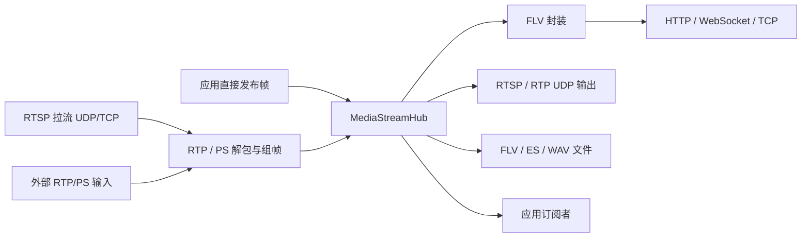

# 架构与扩展

Serein 的边界是媒体数据。设备发现、设备鉴权、SIP 注册、目录查询和业务呼叫不进入媒体内核。

## 分层

- `Serein.Media`：不依赖 ASP.NET Core，包含帧、RTP/PS、音频和 Hub。使用 Microsoft.Extensions 的托管宿主抽象。
- `Serein.Rtsp`：依赖 Media，负责 RTSP、FLV 和文件封装。
- `Serein.Hosting`：在 DI 中注册共享 Hub，管理配置源、重连和可选 RTSP 输出的生命周期。
- `Serein.AspNetCore`：把同一个 Hub 输出为 HTTP/WS-FLV，并映射只读状态端点。

## 媒体格式

视频以 Annex B NAL 数据和毫秒时间戳进入统一帧；`MediaCodec` 是负载类型标识，不代表存在该编码的解码器。FLV 输出使用 AVC 或 Enhanced FLV HEVC 配置记录。PS 解析根据 PSM 识别编码。RTP 分片在接收器中重组后再发布。

`PsRtpReceiver.RegisterStream` 绑定 SSRC 和应用自己的流标识。这个操作只修改内存中的媒体路由表，不发送设备注册或控制消息。

## 生命周期与所有权

`Create` / `TakeOwnership` 返回一个帧引用。借用回调不得释放上游引用；需要持有时使用 `TryRetain` 并确认成功。RTSP 拉流事件和订阅队列交付一个由消费方释放的引用；PS/RTP 接收器事件借用帧，接收器在回调完成后释放。`PsRtpSource` 的桥接回调遵循接收器的所有权契约。

实时订阅使用有界队列。视频队列溢出后丢弃过时 GOP，并等待关键帧恢复。录制使用独立的写盘队列；停止时排空并关闭文件。停机必须先停止源和输出，再释放 Hub。

## 扩展

自定义输入只需发布 `PooledMediaFrame`；自定义输出可订阅 Hub 或使用同步 `FramePublishedCallback`。`RecorderFactory` 可替换录制器，事件可对接业务通知。当前没有内置 HTTP WebHook 投递、设备控制或分布式集群。

视频转码、HLS、MP4、WebRTC 等应作为独立媒体模块实现，并遵守纯托管依赖边界。
